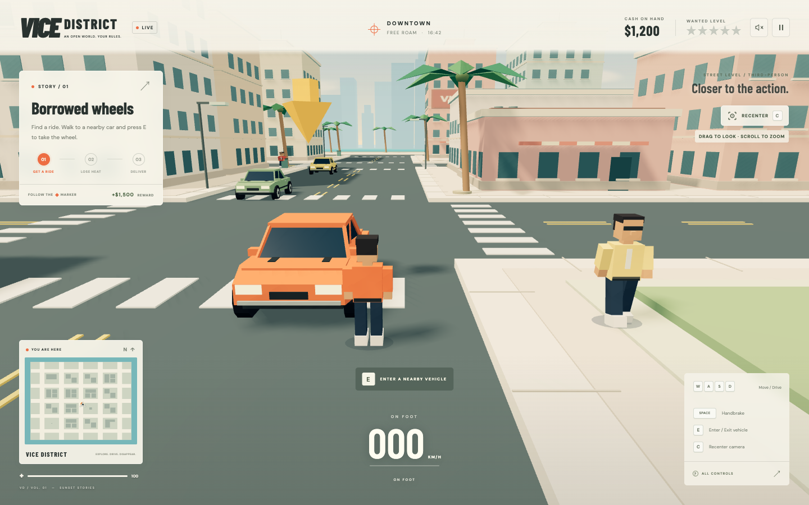

# Vice District

An original GTA-inspired arcade sandbox: explore a sunlit coastal city, borrow a car, lose the police, and make your next delivery. A street-level third-person camera follows behind your character on foot and becomes a chase camera while driving. Built with TypeScript, Three.js, and Vite, with a procedural 3D city, traffic, pedestrians, vehicle handling, police pursuit, missions, and a live minimap.



This is a compact single-player browser game, not a commercial Grand Theft Auto recreation. The city, branding, models, and presentation are original. It has no weapons, multiplayer, or AAA-scale campaign.

## Run locally

Use Node.js 22.12 or newer and a browser with WebGL enabled.

```sh
npm ci
npm run dev
```

Open the local URL printed by Vite, then select **Hit the streets**. Sound starts muted; use the speaker button to enable the synthesized engine and game sounds.

```sh
npm run build       # Type-check and build into dist/
npm run preview     # Serve the production build locally
npm test            # Run game-mechanics tests
npx playwright install chromium
npm run test:e2e    # Run browser gameplay tests
UPDATE_SCREENSHOTS=1 npm run test:e2e # Refresh the checked-in game screenshots
```

## Controls

| Control           | Action                                                                           |
| ----------------- | -------------------------------------------------------------------------------- |
| WASD / arrow keys | Walk relative to the camera; accelerate, reverse, and steer relative to your car |
| Drag the scene    | Orbit the camera around your character or car                                    |
| Scroll wheel      | Zoom the camera closer or farther away                                           |
| C / camera button | Recenter the camera behind your character or car                                 |
| E                 | Enter a nearby car, or exit after slowing down                                   |
| Space             | Handbrake                                                                        |
| Shift             | Sprint on foot / boost while driving                                             |
| R                 | Recover and repair at the garage for $250                                        |
| Escape / P        | Pause or resume                                                                  |
| Speaker button    | Enable or mute sound                                                             |

Touchscreens also have directional, enter/exit, and brake buttons. Hold a direction with one finger and drag the scene with another to look around while moving. Tap **Recenter** to return the camera behind your character or car. The **All controls** button opens the in-game guide; on smaller screens, open it from the pause menu.

For example, while walking down a street, drag to look toward the orange Comet GT and hold **W** to walk toward that view. After entering it, **W** accelerates in the car's direction and **A / D** steer. You can look around independently, then press **C** to restore the view behind the car.

## Your first job

1. Walk up to the orange Comet GT and press **E**. Taking a new car attracts police attention.
2. Get out of police sight. After the crime grace period, remain unseen for eight seconds per wanted star to lose the heat; buildings can block police sightlines.
3. Follow the golden marker to Sunset Customs and slow to below approximately 14 km/h inside the delivery area.
4. Collect **$1,500**, then continue with delivery jobs around the city. New crimes interrupt deliveries until you lose the heat again.

Watch your health and wanted stars. Recovery repairs your ride and clears the heat for $250; getting busted costs $500. Either interrupts the job and puts you back on foot. Take a car to restart the job; recovery never pays a delivery reward.

## Saving and scope

Cash and completed-job count are saved to browser `localStorage`. Reloading resets the active session: player and vehicle positions, current mission stage, health, and police heat. Clearing browser storage removes saved progress. If browser storage is unavailable, the game remains playable without persistence.

All city geometry and game models are generated in code; no external game assets are required. Optional Google Fonts enhance the interface when available, with system-font fallbacks. WebGL is required for the 3D scene; enable browser hardware acceleration if the city cannot initialize.

## Play online

[Play the hosted game](https://intrepion.github.io/kata-grand-theft-auto-astra-6-ultra/)
